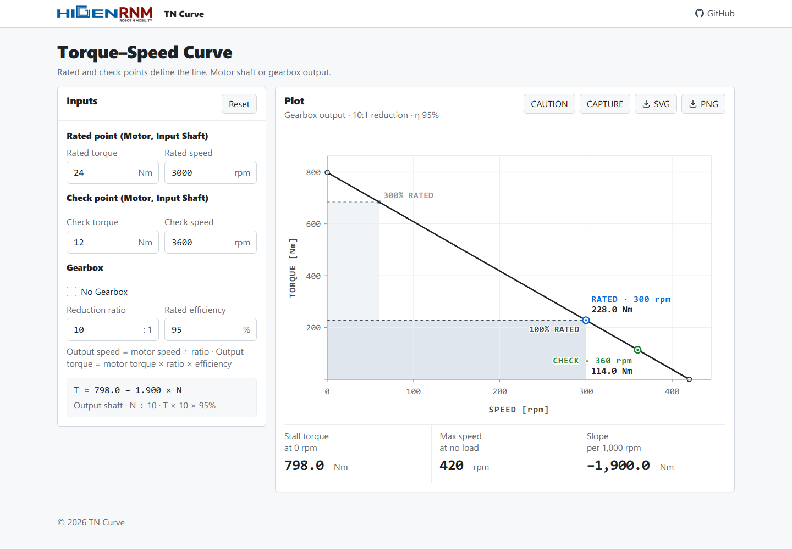

# TN Curve

English | [Korean](README_KO.md)

A static web tool that draws a straight TN curve (torque–speed curve) from a motor's **rated point** and **check point**. By default the values are converted to the gearbox output shaft using the reduction ratio and rated efficiency; enable **No Gearbox** to use the motor/input-shaft values directly.

No server or database is required. The tool runs from `index.html` and static assets, and can be deployed to GitHub Pages as-is. All calculations and image generation happen in the browser.



## Features

- Rated torque/speed and check torque/speed inputs (motor, input shaft)
- Reduction ratio and rated efficiency inputs
- **No Gearbox** option: sets the ratio to 1 and efficiency to 100% and locks both fields
- Extends the line through both points to the y-axis (0 rpm) and x-axis (0 Nm)
- **100%** and **300%** rated-torque guides with shaded bands below them (lighter below 300%, darker below 100%)
- Reports the x-intercept as max speed at no load
- Live speed/torque readout while hovering over the curve
- **NOAH**: reads `docs/NOAH.csv`, lists the models in a dialog, and fills the form from the selected model
- **CAPTURE**: copies the plot to the clipboard as a PNG for pasting with `Ctrl+V` (`Cmd+V` on macOS)
- **CAUTION**: explains the limits of the simplified model (no magnetic saturation, temperature, motor/drive/bearing efficiency; gearbox efficiency treated as a constant)
- **SVG** (vector) and **PNG** (1800 × 1200) downloads
- Responsive layout, keyboard focus styles, and reduced-motion support

## NOAH model data

The **NOAH** button reads `docs/NOAH.csv` and shows the available models in a table. Select a row and choose **OK** to fill the motor and gearbox inputs. The CSV uses the columns `Development Name`, `Production Name`, `Rated Speed`, `Rated Torque`, `Check Speed`, `Check Torque`, `Ratio`, and `Eff.` (percent).

When the page is opened directly from disk (`file://`), browsers block `fetch`. In that case the app falls back to the bundled `docs/NOAH-data.js`, which is generated from `docs/NOAH.csv`. When the page is served over HTTP, the live CSV is used.

## Calculation rules

### 1. Motor input

The rated and check torque/speed values are **motor-side (input-shaft) inputs**.

### 2. Gearbox output conversion

The ratio `i` and rated efficiency `η` (%) convert the motor values to the output shaft:

```text
N_out = N_motor / i
T_out = T_motor × i × (η / 100)
```

- `i` is **motor speed ÷ output speed**. `10` means 10:1 reduction.
- `η` is entered as a percentage. `95` means 95%.
- The ratio must be at least 1; efficiency must be greater than 0% and at most 100%.
- The plot, 100%/300% guides, and axis intercepts are calculated on the **output shaft**.
- The rated/check fields keep the motor-side values.
- With **No Gearbox** enabled, `i = 1` and `η = 100%`, the two fields are locked, and the output values equal the motor values. Unchecking restores the previously entered gearbox values.

### 3. Line and guides

Using the two points `(N₁, T₁)` and `(N₂, T₂)` on the plot basis:

```text
m = (T₂ − T₁) / (N₂ − N₁)
T = m·N + b
```

- y-intercept: `(0, b)` — torque at 0 rpm (stall torque)
- x-intercept: `(b / −m, 0)` — speed at 0 Nm, shown as max speed at no load
- 300% guide: `T = 3 × rated torque` (on the selected output basis)
- 100% guide: `T = rated torque` (on the selected output basis)
- Each guide starts at speed 0 and stops where it meets the curve. The shaded band below each guide uses the same extent.

> If 300% of rated torque is above the 0-rpm intercept, the guide cannot meet the curve. The tool shows a warning and draws the 300% level as a dashed line without shading.

## Simplified model

The chart is intended for preliminary sizing and reference only. The model does not consider magnetic saturation, temperature effects, motor efficiency, drive efficiency, or bearing efficiency, and it treats gearbox efficiency as a constant. Physical testing is required to obtain accurate performance data.

## Local preview

No build step is required. Serve the repository root with any static server:

```bash
npx serve .
# or
python -m http.server 4173
```

Open `http://localhost:3000` or `http://localhost:4173`.

> Opening `index.html` directly via `file://` also works; NOAH uses the bundled fallback data, and a local server avoids browser-specific download restrictions.

## GitHub Pages deployment

1. Go to the repository's **Settings → Pages**.
2. Under **Build and deployment → Source**, choose **GitHub Actions**.
3. Push to `main`, or run **Actions → Deploy TN Curve to GitHub Pages → Run workflow**.
4. When the workflow finishes, the site is available at:

```text
https://dhkima-higenmotor.github.io/TN-CURVE/
```

Workflow: [`.github/workflows/deploy-pages.yml`](.github/workflows/deploy-pages.yml)

- The workflow uploads `index.html`, `assets/`, `docs/NOAH.csv`, `docs/NOAH-data.js`, and `.nojekyll` without a build step.
- The repository root is the deployment unit; no framework or Node runtime is required.
- To use a custom domain, connect it in the Pages settings.

## Project structure

```text
.
├─ index.html
├─ assets/
│  ├─ app.js          # curve math, SVG rendering, PNG export, interactions
│  ├─ styles.css      # responsive UI
│  └─ LOGO_HIGENRNM_smaller.png   # header brand logo
├─ .github/
│  └─ workflows/
│     └─ deploy-pages.yml
├─ docs/
│  ├─ NOAH.csv
│  ├─ NOAH-data.js
│  └─ preview.png
├─ .nojekyll
├─ README.md
└─ README_KO.md
```

## Notes

- The SVG is generated entirely in the browser as a standalone file; no image server is needed.
- PNG export renders the SVG through a `<canvas>` at 1800 × 1200.
- **CAPTURE** writes a PNG of the plot to the clipboard (requires a secure context and browser clipboard support).
- Inputs are never transmitted or stored.
- Supported in current versions of Chrome, Edge, Safari, and Firefox.
