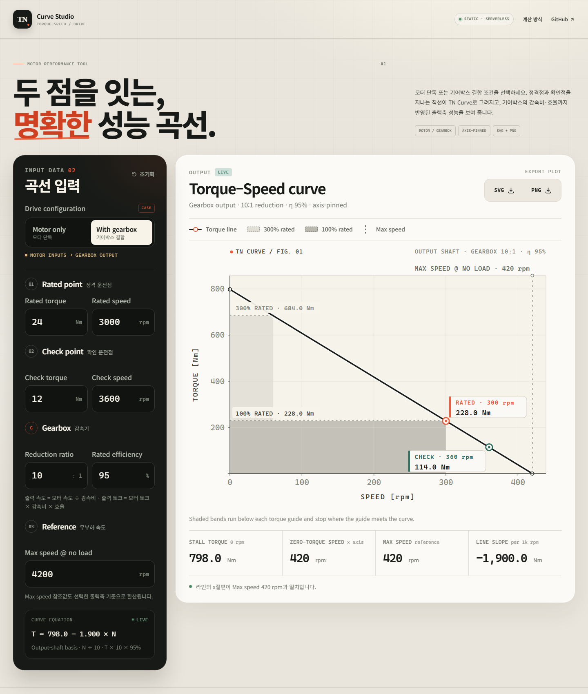

# TN Curve Studio

모터의 **Rated Point**와 **Check Point**를 이용해 직선형 TN Curve(Torque–Speed Curve)를 그리고, SVG 또는 PNG로 내려받는 정적 웹 도구입니다. **모터 단독**과 **기어박스 결합** 조건을 선택할 수 있으며, 기어박스의 감속비·정격효율을 반영한 출력축 성능을 플롯합니다.

서버나 데이터베이스 없이 `index.html`과 정적 asset만으로 동작하며, GitHub Pages에 그대로 배포할 수 있습니다. 모든 계산과 이미지 생성은 사용자의 브라우저에서 실행됩니다.



## 기능

- **Motor only / With gearbox** 케이스 선택
- Rated Torque / Rated Speed, Check Torque / Check Speed 입력
- 기어박스 모드: **감속비율**(reduction ratio)과 **정격효율**(rated efficiency) 추가 입력
- 두 운전점을 지나는 직선을 플롯 기준축의 y축(0 rpm)·x축(0 Nm)까지 연장
- Rated Torque의 **100%** 가이드와 **300%** 가이드 표시
- 각 가이드 아래 영역을 밝은 회색 / 진한 회색으로 채움
- Max Speed @ No Load를 세로 참조선으로 표시
- 곡선 위 마우스 위치의 Speed / Torque를 실시간 확인
- **SVG**(벡터) 및 **PNG**(1800 × 1200) 다운로드
- 반응형 레이아웃, 키보드 포커스, 모션 감소 설정 대응

## 계산 규칙

### 1. 모터축 입력

`Rated Torque / Speed`와 `Check Torque / Speed`, `Max Speed @ No Load`는 **모터축 기준 입력값**입니다.

### 2. 기어박스가 있는 경우

감속비 `i`, 정격효율 `η`(%)를 사용해 출력축 값으로 환산합니다.

```text
N_out = N_motor / i
T_out = T_motor × i × (η / 100)
N_max,out = N_max,motor / i
```

- 감속비 `i`는 **모터축 속도 ÷ 출력축 속도**입니다. `10`은 `10:1` 감속을 의미합니다.
- 정격효율 `η`는 `%` 단위로 입력합니다. `95`는 95%를 의미합니다.
- `i = 1`, `η = 100`이면 모터 단독과 동일합니다.
- 감속비는 `1` 이상, 효율은 `0%` 초과 `100%` 이하로 검증합니다.
- 플롯, 100%·300% 가이드, Max Speed 참조선, 축 절편은 모두 **출력축 기준**으로 계산됩니다.
- 입력 필드의 Rated/Check/Reference 값은 모터축 값 그대로 유지됩니다.

### 3. 직선과 가이드

플롯 기준축의 두 점 `(N₁, T₁)`, `(N₂, T₂)`로 직선을 계산합니다.

```text
m = (T₂ − T₁) / (N₂ − N₁)
T = m·N + b
```

- y축 절편: `(0, b)` → 0 rpm에서의 토크
- x축 절편: `(b / −m, 0)` → 토크가 0이 되는 속도
- 300% 가이드: `T = 3 × Rated Torque` (선택한 출력축 기준)
- 100% 가이드: `T = Rated Torque` (선택한 출력축 기준)
- 각 가이드는 Speed 0에서 시작해 곡선과 만나는 지점까지만 그립니다.
- **Max Speed @ No Load는 참조값입니다.** 직선을 결정하는 값은 Rated/Check 두 점이며, Max speed는 플롯 위 참조선과 x절편 비교를 위해 사용됩니다. 세 값이 일치하면 자연스럽게 같은 위치에 표시됩니다.

> 300% 토크가 0 rpm 절편보다 높으면 가이드가 곡선과 만날 수 없습니다. 이 경우 도구가 경고를 표시하고, 300% 기준선만 점선으로 보여 줍니다.

## 로컬 미리보기

별도 빌드 과정이 없습니다. 저장소 루트에서 정적 서버만 실행하면 됩니다.

```bash
# Node.js
npx serve .

# 또는 Python
python -m http.server 4173
```

브라우저에서 `http://localhost:3000` 또는 `http://localhost:4173`을 엽니다.

> `index.html`을 `file://`로 직접 열어도 동작하지만, 브라우저별 다운로드 제한을 피하려면 로컬 서버 사용을 권장합니다.

## GitHub Pages 배포

1. GitHub 저장소의 **Settings → Pages**로 이동합니다.
2. **Build and deployment → Source**를 **GitHub Actions**로 선택합니다.
3. `main` 브랜치에 push하거나 **Actions → Deploy TN Curve to GitHub Pages → Run workflow**를 실행합니다.
4. 워크플로가 완료되면 아래 주소에서 확인할 수 있습니다.

```text
https://dhkima-higenmotor.github.io/TN-CURVE/
```

워크플로 파일: [`.github/workflows/deploy-pages.yml`](.github/workflows/deploy-pages.yml)

- 빌드 스텝 없이 `index.html`, `assets/`, `.nojekyll`만 artifact로 업로드합니다.
- 저장소 루트가 곧 배포 단위이므로, 별도 프레임워크나 Node 런타임이 필요하지 않습니다.
- 커스텀 도메인을 사용할 경우 Pages 설정에서 도메인을 연결하면 됩니다.

## 파일 구조

```text
.
├─ index.html
├─ assets/
│  ├─ app.js          # 곡선 계산, SVG 렌더링, PNG 변환, 상호작용
│  ├─ styles.css      # 반응형 UI
│  └─ favicon.svg
├─ .github/
│  └─ workflows/
│     └─ deploy-pages.yml
├─ docs/
│  └─ preview.png
├─ .nojekyll
└─ README.md
```

## 참고

- SVG 플롯은 브라우저에서 직접 생성한 standalone SVG입니다. 별도 이미지 서버가 필요하지 않습니다.
- PNG는 SVG를 브라우저의 `<canvas>`로 렌더링해 1800 × 1200 해상도로 저장합니다.
- 입력값은 어디에도 전송되거나 저장되지 않습니다.
- 최신 Chrome, Edge, Safari, Firefox를 지원합니다.
