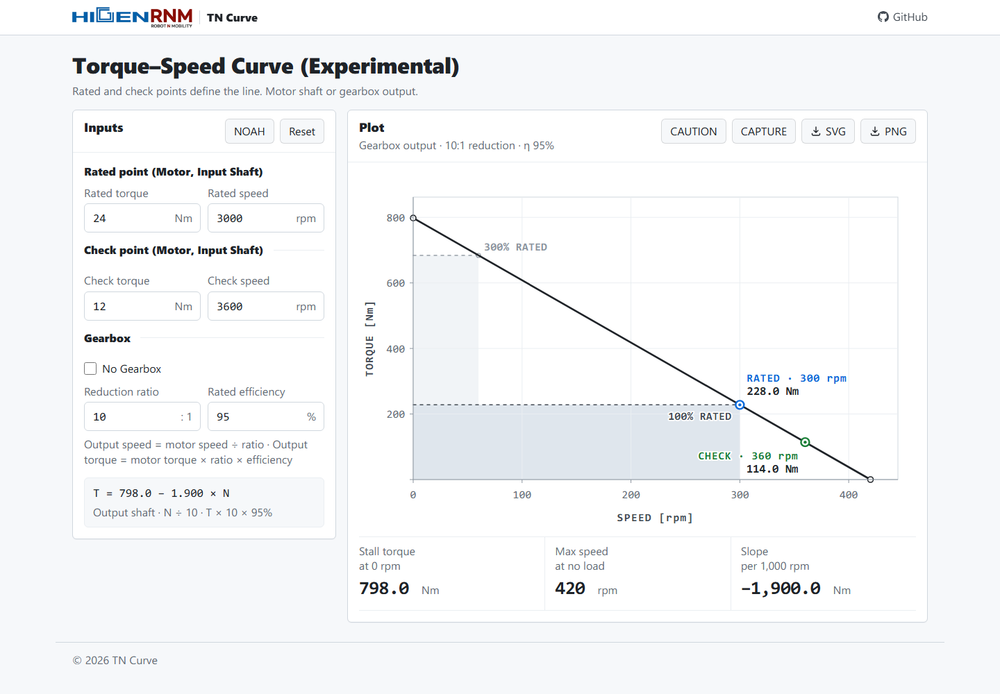

# TN Curve

[English](README.md) | 한국어

모터의 **Rated Point**와 **Check Point**로 직선형 TN Curve(Torque–Speed Curve)를 그리는 정적 웹 도구입니다. 기본 계산은 기어박스의 감속비·정격효율을 반영한 출력축 기준이며, **No Gearbox**를 켜면 모터축(입력축) 값을 그대로 사용합니다.

서버나 데이터베이스 없이 `index.html`과 정적 asset만으로 동작하며, GitHub Pages에 그대로 배포할 수 있습니다. 모든 계산과 이미지 생성은 브라우저에서 실행됩니다.



## 기능

- Rated Torque/Speed, Check Torque/Speed 입력 (Motor, Input Shaft 기준)
- 감속비(reduction ratio)와 정격효율(rated efficiency) 입력
- **No Gearbox** 옵션: 감속비 1, 정격효율 100%로 자동 설정되고 두 입력은 잠금
- 두 운전점을 지나는 직선을 y축(0 rpm)·x축(0 Nm)까지 연장
- **100%**·**300%** 정격 토크 가이드와 가이드 아래 음영 (300% 아래는 연한 회색, 100% 아래는 더 진한 회색)
- x축 절편을 무부하 최대 속도(Max speed at no load)로 표시
- 그래프 위 마우스 위치의 Speed/Torque 실시간 표시
- **NOAH**: `docs/NOAH.csv`를 읽어 모델 목록을 표로 보여 주고, 선택한 모델의 파라미터를 폼에 자동 입력
- **CAPTURE**: 그래프를 PNG 이미지로 클립보드에 복사해 `Ctrl+V`(macOS는 `Cmd+V`)로 붙여넣기
- **CAUTION**: 단순화 모델의 한계 안내 (자속포화·온도·모터/드라이브/베어링 효율 미반영, 기어박스 효율 상수 취급)
- **SVG**(벡터) 및 **PNG**(1800 × 1200) 다운로드
- 반응형 레이아웃, 키보드 포커스, 모션 감소 설정 대응

## NOAH 모델 데이터

**NOAH** 버튼은 `docs/NOAH.csv`를 읽어 사용 가능한 모델을 표로 보여 줍니다. 행을 선택하고 **OK**를 누르면 Motor·Gearbox 입력값이 자동으로 채워집니다. CSV 컬럼은 `Development Name`, `Production Name`, `Rated Speed`, `Rated Torque`, `Check Speed`, `Check Torque`, `Ratio`, `Eff.`(% 단위)입니다.

`index.html`을 디스크에서 직접 열면(`file://`) 브라우저가 `fetch`를 차단하므로, 이때는 `docs/NOAH.csv`에서 생성한 `docs/NOAH-data.js` 번들 데이터를 사용합니다. HTTP로 서빙할 때는 최신 CSV를 직접 읽습니다.

## 계산 규칙

### 1. 모터축 입력

`Rated Torque/Speed`와 `Check Torque/Speed`는 **모터축(Input Shaft) 기준 입력값**입니다.

### 2. 기어박스 출력축 환산

감속비 `i`와 정격효율 `η`(%)로 모터축 값을 출력축 값으로 환산합니다.

```text
N_out = N_motor / i
T_out = T_motor × i × (η / 100)
```

- `i`는 **모터축 속도 ÷ 출력축 속도**입니다. `10`은 10:1 감속입니다.
- `η`는 `%` 단위입니다. `95`는 95%입니다.
- 감속비는 1 이상, 효율은 0% 초과 100% 이하만 허용합니다.
- 플롯, 100%·300% 가이드, 축 절편은 모두 **출력축 기준**입니다.
- Rated/Check 입력 필드는 모터축 값을 유지합니다.
- **No Gearbox**를 켜면 `i = 1`, `η = 100%`가 되고 두 입력은 수정할 수 없습니다. 이때 출력축 값은 모터축 값과 같으며, 해제하면 이전에 입력한 기어박스 값이 복원됩니다.

### 3. 직선과 가이드

플롯 기준축의 두 점 `(N₁, T₁)`, `(N₂, T₂)`로 직선을 계산합니다.

```text
m = (T₂ − T₁) / (N₂ − N₁)
T = m·N + b
```

- y절편: `(0, b)` — 0 rpm에서의 토크(정지 토크)
- x절편: `(b / −m, 0)` — 0 Nm가 되는 속도, 무부하 최대 속도로 표시
- 300% 가이드: `T = 3 × Rated Torque` (선택한 출력축 기준)
- 100% 가이드: `T = Rated Torque` (선택한 출력축 기준)
- 각 가이드는 Speed 0에서 시작해 곡선과 만나는 지점까지만 그립니다. 가이드 아래 음영도 같은 범위에 적용됩니다.

> 300% 토크가 0 rpm 절편보다 높으면 가이드가 곡선과 만나지 않습니다. 이때 경고를 표시하고 300% 기준선은 음영 없이 점선으로만 그립니다.

## 단순화 모델

이 그래프는 예비 검토용입니다. 자속포화, 온도, 모터 효율, 드라이브 효율, 베어링 효율을 고려하지 않으며 기어박스 효율은 상수로 취급합니다. 정확한 성능은 실험을 통해 확인해야 합니다.

## 로컬 미리보기

별도 빌드가 필요 없습니다. 저장소 루트에서 정적 서버를 실행합니다.

```bash
npx serve .
# 또는
python -m http.server 4173
```

`http://localhost:3000` 또는 `http://localhost:4173`을 엽니다.

> `index.html`을 `file://`로 직접 열어도 동작합니다. NOAH는 번들 데이터를 사용하며, 로컬 서버를 사용하면 브라우저별 다운로드 제한을 피할 수 있습니다.

## GitHub Pages 배포

1. 저장소의 **Settings → Pages**로 이동합니다.
2. **Build and deployment → Source**를 **GitHub Actions**로 선택합니다.
3. `main`에 push하거나 **Actions → Deploy TN Curve to GitHub Pages → Run workflow**를 실행합니다.
4. 워크플로가 끝나면 아래 주소에서 확인할 수 있습니다.

```text
https://dhkima-higenmotor.github.io/TN-CURVE/
```

워크플로: [`.github/workflows/deploy-pages.yml`](.github/workflows/deploy-pages.yml)

- 빌드 없이 `index.html`, `assets/`, `docs/NOAH.csv`, `docs/NOAH-data.js`, `.nojekyll`을 artifact로 업로드합니다.
- 저장소 루트가 배포 단위이며 별도 프레임워크나 Node 런타임이 필요 없습니다.
- 커스텀 도메인은 Pages 설정에서 연결합니다.

## 파일 구조

```text
.
├─ index.html
├─ assets/
│  ├─ app.js          # 곡선 계산, SVG 렌더링, PNG 변환, 상호작용
│  ├─ styles.css      # 반응형 UI
│  └─ LOGO_HIGENRNM_smaller.png   # 헤더 브랜드 로고
├─ .github/
│  └─ workflows/
│     └─ deploy-pages.yml
├─ docs/
│  ├─ NOAH.csv
│  ├─ NOAH-data.js
│  └─ preview.png
├─ .nojekyll
├─ README.md
└─ README_KO.md
```

## 참고

- SVG는 브라우저에서 생성되는 standalone 파일이며 이미지 서버가 필요 없습니다.
- PNG는 SVG를 `<canvas>`로 렌더링해 1800 × 1200으로 저장합니다.
- **CAPTURE**는 보안 컨텍스트와 브라우저의 클립보드 지원이 필요하며, PNG 이미지로 복사되어 `Ctrl+V`(macOS `Cmd+V`)로 붙여넣을 수 있습니다.
- 입력값은 어디에도 전송되거나 저장되지 않습니다.
- 최신 Chrome, Edge, Safari, Firefox를 지원합니다.
